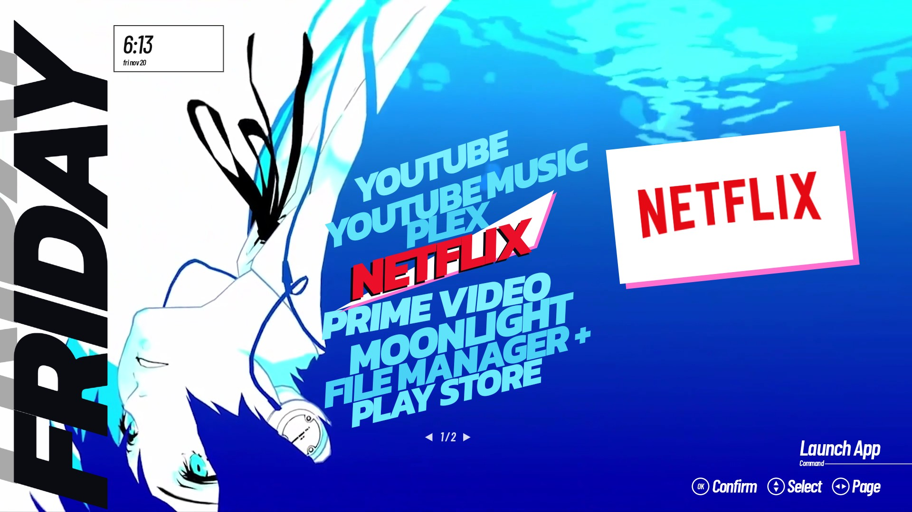

# Deepblue_Bravia



A debloat kit and a fast custom home screen for Sony BRAVIA TVs running Google TV, done entirely over ADB on your
home network. No root.

- **`debloat.sh`** removes or disables the preinstalled apps and background services you don't use, and makes the
  system animations a little faster. Every change is undoable.
- **DeepBlue** (`launcher/`) is a home screen that replaces Google TV's, styled after the Persona 3 Reload menu: a
  vertical, slanted app menu over a Makoto Yuki clip, with a live preview of each app's banner, UI sounds, and an
  entrance animation. It holds 60 fps on the TV and draws nothing when an app is open.

Tested on a **Sony A80CJ** (MediaTek MT5895, Android 12 Google TV). Other BRAVIAs on Google TV with Android 12
or newer are expected to work but have not been tested; please open an issue with your model either way.

## What you need

- A BRAVIA on Google TV, Android 12 or newer (Settings > System > About).
- A Linux PC on the same network, with `adb` ([platform-tools](https://developer.android.com/tools/releases/platform-tools)).
  The scripts also look for it in `./platform-tools/`.
- For building the home screen: a JDK (17 or newer) and the Android SDK in `./android-sdk/` with `platforms;android-34`
  and `build-tools;35.0.0`:
  ```bash
  sdkmanager --sdk_root=android-sdk "platforms;android-34" "build-tools;35.0.0"
  ```

## Connect to the TV

1. On the TV: Settings > System > About, select the build number 7 times to unlock Developer options.
2. In Developer options, turn on USB debugging.
3. Find the TV's IP address (Settings > Network & Internet), then:
   ```bash
   adb connect <tv-ip>:5555
   ```
   Accept the prompt on the TV. Every script takes the address the same way: `TV=<tv-ip>:5555 ./script.sh`.

## Before you start: Wi-Fi

Android deletes the Wi-Fi networks an app saved when that app is disabled or removed. A network you joined during the
TV's first setup belongs to Google TV's setup and home apps, which the home screen install disables, so the TV would
drop off Wi-Fi. Both scripts check this and stop. If they do: on the TV, open Settings > Network & Internet, forget your
network and join it again (it then belongs to Settings), and run the script again. Wired Ethernet is not affected.

## Debloat

Read the three lists at the top of `debloat.sh` first and delete any line you want to keep. They match one owner's
choices: besides demos, logging, telemetry and Sony extras, they remove **antenna / live TV setup, AirPlay and
HomeKit, voice search, Google Home control, the phone remote, and several streaming apps**. Apps your TV doesn't have
are skipped.

```bash
TV=<tv-ip>:5555 ./debloat.sh            # remove and disable
TV=<tv-ip>:5555 ./debloat.sh restore    # put everything back
```

- `README_PKGS` and `EXTRA_PKGS` are uninstalled for your user (`pm uninstall --user 0`). Preinstalled apps stay on
  the read-only system partition, so `restore` brings them back. Apps that came from the Play Store are removed
  completely: reinstall those from the Play Store.
- `DISABLE_PKGS` are disabled, not removed.
- `KEEP` lists packages that cause boot loops or break core features when removed; the script refuses to run if one
  of them appears in a removal list.
- A factory reset also undoes everything.

## Home screen

```bash
cd launcher
./build.sh                          # builds build/DeepBlue.apk (no Gradle)
TV=<tv-ip>:5555 ./install.sh        # installs it and makes it the home screen
TV=<tv-ip>:5555 ./install.sh restore   # gives Home back to Google TV
```

Google TV's home and setup apps claim Home at a priority only system apps may use, so `install.sh` disables them
(`restore` enables them again). DeepBlue is a normal app: `adb uninstall com.deepblue.shell` removes it.

On the remote: up and down select, left and right change page, OK opens the app. Page 1 holds the apps pinned in
`PINNED` in `Home.java`; the rest follow by how often you open them, and System (TV settings) is always last.

`build.sh` signs with a debug key it creates as `launcher/debug.keystore` (ignored by git). Keep it: an update must be
signed with the same key to install over the app.

### Background

The Makoto Yuki clip comes with the repo: `launcher/tv-media/art.intro.mp4` plays once on each return home and
`art.loop.mp4` loops after it. `install.sh` copies both to the TV.

- **Your own video:** replace those two files (1080p, ideally 60 fps). The menu starts on the intro's first frame and
  slides in about 0.2 s later.
- **No video:** delete them before installing, and DeepBlue draws its own animated water instead. If they are already
  on the TV: `adb shell rm /sdcard/Android/data/com.deepblue.shell/files/art.*.mp4`.
- **Picture:** `art.webp` or `art.png` (animated WebP works), shown on the left over the water. Copy it to
  `/sdcard/Android/data/com.deepblue.shell/files/` on the TV.

### Browser prototype

`launcher/prototype/index.html` is the same menu in a browser canvas, for trying out changes before building:

```bash
python3 -m http.server 8792 --bind 127.0.0.1 --directory launcher
```

Then open <http://localhost:8792/prototype/>. Arrow keys and Enter drive it. `TV=<tv-ip>:5555
launcher/prototype/pull_banners.sh` copies your TV's real app list and banners into it.

### Deck editor theme (prototype)

`launcher/prototype/deck.html` is a second theme: your apps are cards in the deck editor of
Yu-Gi-Oh! GX Tag Force (PSP). Pinned apps are the Deck, the rest the Side Deck; OK summons a card, a tag partner
comments, and Duel Academy sits behind it all by time of day.

None of the game's art, sounds or movies is in this repository. Build them from your own copy of the game and the
[TFHD-2022 HD texture pack](https://forums.ppsspp.org/showthread.php?tid=28535) (needs Pillow, `7z` and `ffmpeg`; about
two minutes, 21 MB, ignored by git):

```bash
launcher/prototype/deck/make_assets.py "<Tag Force ISO>" "<HD pack>/ULUS10136"
```

Then open <http://localhost:8792/prototype/deck.html> from the same server as above.

| Key | Does |
|---|---|
| Arrows | choose a card |
| Enter | summon it (a monster from the Deck plays the partner's summon movie; Enter skips) |
| Hold Enter | pick the card up; arrows move it between and inside the decks, Enter drops it |
| M or Esc | menu: partner, theme, and which of the game's sounds each action uses (Back on a remote) |
| R / H | default deck / replay coming Home |

The script is tested with the European ISO. The DeepBlue prototype has the same M / Esc menu to switch theme.

**On the TV** the launcher shows this same page full screen, with your real apps and the remote. Once the game files
are built, `install.sh` copies them and the page to the TV. From the DeepBlue home screen press Back twice to switch to
the deck theme; in the deck theme Back opens the menu, where Theme switches back. Or from the PC:

```bash
adb shell am start -n com.deepblue.shell/.Home --es theme deck    # or: persona
```

After changing `deck.html`, run `install.sh` again (or `adb push` it to
`/sdcard/Android/data/com.deepblue.shell/files/web/`). The page's messages and its frame rate show in
`adb logcat -s DeepBlue`. The app needs the Internet permission for this theme, to load two fonts from Google Fonts.

### Sounds

`launcher/make_sounds.py` synthesizes the four UI sounds into `launcher/res/raw/` with the standard library only.

## Notes

- `com.mediatek.dmagent` is a persistent system app that restarts at every boot whatever its state; it sits idle.
- Removing the bloat frees memory and CPU, but some vendor services keep running (Sony's audio processing uses part
  of one core at all times).

## Credits and license

- The starting package list comes from
  [sony-google-tv-debloat](https://github.com/ironshadow786786-boop/sony-google-tv-debloat).
- Fonts: [Kanit](https://github.com/google/fonts/tree/main/ofl/kanit) and
  [Barlow Condensed](https://github.com/google/fonts/tree/main/ofl/barlowcondensed), under the SIL Open Font License
  (the license texts sit next to the fonts in `launcher/assets/fonts/`).
- The Makoto Yuki clip in `launcher/tv-media/` is footage from Persona 3 Reload (© ATLUS / SEGA), smoothed to 60 fps
  and included as fan use. It is not covered by the MIT license.
- The deck editor theme uses nothing of Konami's from this repository: `make_assets.py` builds its files on your
  machine from your own game and from chrisfand's TFHD-2022 texture pack.
- Everything else: MIT, see `LICENSE`.

This project is not affiliated with Sony, Google, ATLUS, SEGA or Konami. BRAVIA, Google TV, Persona and Yu-Gi-Oh! are
their owners' trademarks.
